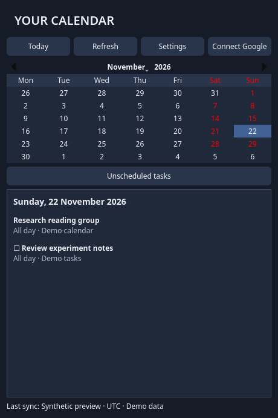

# Desktop Calendar

[](https://github.com/0xSaadBinSultan/laptop-calendar-widget/actions/workflows/desktop.yml)

A read-only Google Calendar and Tasks desktop companion. Browse your month,
view the day's agenda, and keep the last successful sync available offline.

**Windows, macOS and Linux:** portable Qt desktop app with native window movement,
resizing, adjustable transparency and Google connection settings.
**XFCE/X11:** the original GTK wallpaper widget is also available.



## Choose your version

| Platform | Interface | Setup |
| --- | --- | --- |
| Windows 10/11, x64 | Qt desktop app | Python setup below, or a successful Windows Actions build |
| macOS 14+, Apple Silicon / Intel | Qt desktop app | Python setup below; Actions builds target Apple Silicon |
| Linux x64, X11 or Wayland | Qt desktop app | Python setup below; normal application window |
| Debian/Kali XFCE, X11 | GTK wallpaper widget | [Original XFCE setup](docs/xfce.md) |

Qt's normal desktop window is deliberately independent of window-manager desktop
layer extensions. Wayland and macOS do not promise XFCE-style wallpaper pinning.
ARM Linux depends on availability of Qt wheels and has no CI runner here. No mobile
Android/iOS app is included. See Actions for actual OS build results, not just this table.

## Install and run

Install Python **3.11 or 3.12** from [python.org](https://www.python.org/downloads/),
then clone or download this repository. No administrator access is required by the helper.

```sh
git clone https://github.com/0xSaadBinSultan/laptop-calendar-widget.git
cd laptop-calendar-widget
python install_desktop.py --run
```

On macOS/Linux, use `python3` if `python` is unavailable. On Windows, `py -3.12`
can replace `python`. The helper creates `.venv` inside this checkout and installs
only its Python dependencies. Rerun the same command to launch again.
To preview without a Google account or network:

```sh
python install_desktop.py --run --demo
```

For a manually managed environment:

```sh
python -m pip install -r requirements-desktop.txt
python desktop.py
```

## Connect your Google account

1. In your own Google Cloud project, enable **Google Calendar API** and **Google Tasks API**.
2. Configure the OAuth consent screen. If it is in Testing, add your Google account as a test user.
3. Create an OAuth client with application type **Desktop app** and download its JSON.
4. Open the calendar's **Settings**, choose that JSON, and set an IANA timezone
   such as `Asia/Dhaka`. The account field is optional; set it to enforce a specific account.
5. Click **Connect Google** and review the Calendar/Tasks read-only permissions
   in your browser. Keep the app open until the connection finishes.

The app saves its own refresh token after account verification. It never requests
calendar editing or Tasks editing permissions. Access can be revoked through your
Google Account. Google controls consent, quotas and refresh-token lifetime; external
Testing apps can require reconnecting. See the [OAuth guide](https://developers.google.com/identity/protocols/oauth2/native-app).

## Controls

- Select a day for its events and dated tasks; marked days contain cached items.
- **Unscheduled tasks** shows tasks without due dates. Completed dated tasks remain marked.
- **Today** uses the calendar timezone. Google Tasks due dates are not shifted across timezones.
- **Refresh** synchronizes in a background worker; failed requests preserve the previous cache.
- Drag the native title bar and resize the borders. Window geometry is remembered.
- Change opacity in Settings. Closing the window exits this app; it does not hide in a tray.

Selected visible Google calendars and task lists are read from 62 days ago through
370 days ahead. Availability-only calendars display Busy. Repeating tasks are limited
to instances Google exposes; no future tasks are invented.

## Private storage

| OS | Configuration and OAuth token | Cache |
| --- | --- | --- |
| Windows | `%APPDATA%/LaptopCalendar` | `%LOCALAPPDATA%/LaptopCalendar/Cache` |
| macOS | `~/Library/Application Support/LaptopCalendar` | `~/Library/Caches/LaptopCalendar` |
| Linux | `~/.config/laptop-calendar` | `~/.cache/laptop-calendar` |

Linux respects XDG directory overrides. `LAPTOP_CALENDAR_HOME` redirects config,
cache and state beneath one directory for isolated testing or portable setups.
`python desktop.py --paths` prints locations. Token and cache files are created
atomically with owner-only POSIX permissions; Windows uses the user's inherited ACLs.
Keep these directories and the downloaded OAuth JSON out of Git and public screenshots.
No shared key, Google credentials, private events or hosted backend ship in the app.

## Test and build

```sh
python -m unittest -v test_calendar test_portable
python -m pip install pyinstaller
python -m PyInstaller --noconfirm --clean --onedir --windowed --name DesktopCalendar desktop.py
```

Headless checks use `QT_QPA_PLATFORM=offscreen` and synthetic data. GitHub Actions
runs tests and creates OS-specific artifacts on Windows x64, Linux x64 and macOS
Apple Silicon. Build on the target OS; PyInstaller does not cross-compile.
These are unsigned application builds, not notarized macOS packages or signed
Windows installers. Dependencies retain their own licenses, including Qt/PySide's
applicable LGPL/commercial terms. The original application source is [MIT](LICENSE).

Previews can be regenerated with `python desktop.py --demo --export-preview docs/desktop-preview.png`.
